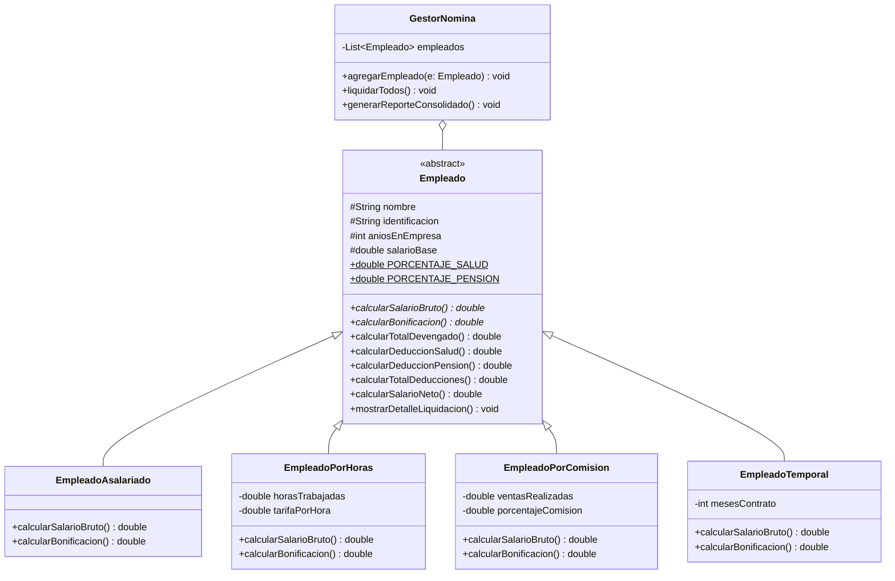

# 💼 Sistema de Gestión de Empleados y Temas Avanzados de POO

Proyecto académico completo en **Java** para **Apache NetBeans**, que cubre:
1. **Punto 1:** Sistema de Liquidación de Nómina con Superclase `Empleado` y 4 Subclases especializadas, deducciones de ley (4% Salud y 4% Pensión) y beneficios según contrato.
2. **Punto 2:** Investigación y demostración práctica de Herencia, Sobrecarga, Sobreescritura, Clases Abstractas, Interfaces, modificador `static`, Catálogo de Patrones de Diseño (Singleton, Adapter, Strategy) y Principios SOLID.

---

## 🏛️ 1. Diagrama de Clases UML (Punto 1 - Nómina)



---

## 📂 2. Estructura del Proyecto

```
GestionEmpleados/
├── pom.xml                                     <- Configuración Maven para NetBeans
├── .gitignore                                  <- Ignora temporales y carpetas /target
├── README.md                                   <- Documentación general
├── docs/
│   ├── diagrama_clases_uml.md                  <- Diagramas UML detallados y POO
│   └── investigacion_punto_2.md                <- Investigación de POO, Patrones y SOLID
└── src/
    └── main/
        └── java/
            └── com/
                └── sistema/
                    ├── empleados/
                    │   ├── modelo/             <- Empleado y sus 4 subclases
                    │   ├── servicio/           <- GestorNomina
                    │   └── app/Main.java       <- Menú interactivo y demostración
                    └── investigacion/
                        ├── poo/                <- Herencia, Sobrecarga, Sobreescritura, etc.
                        ├── patrones/           <- Singleton, Adapter, Strategy
                        └── app/DemoPuntoDos.java <- Ejecutable del Punto 2
```

---

## 🚀 3. Cómo abrir y ejecutar en Apache NetBeans

1. Abre **Apache NetBeans**.
2. Ve a **File > Open Project...** (`Ctrl + Shift + O`).
3. Selecciona la carpeta `GestionEmpleados`.
4. Haz clic en **Open Project**.
5. Presiona **F6** o haz clic en el botón verde ▶ (**Run Project**).
6. Usa el menú interactivo en la consola inferior:
   - **Opción 4:** Demostración completa de Nómina (Punto 1).
   - **Opción 5:** Demostración de POO y Patrones de Diseño (Punto 2).

---

## 📖 4. Documentación y Recursos

- [Diagrama de Clases UML Detallado](docs/diagrama_clases_uml.md)
- [Investigación Completa del Punto 2 (Patrones y SOLID)](docs/investigacion_punto_2.md)
