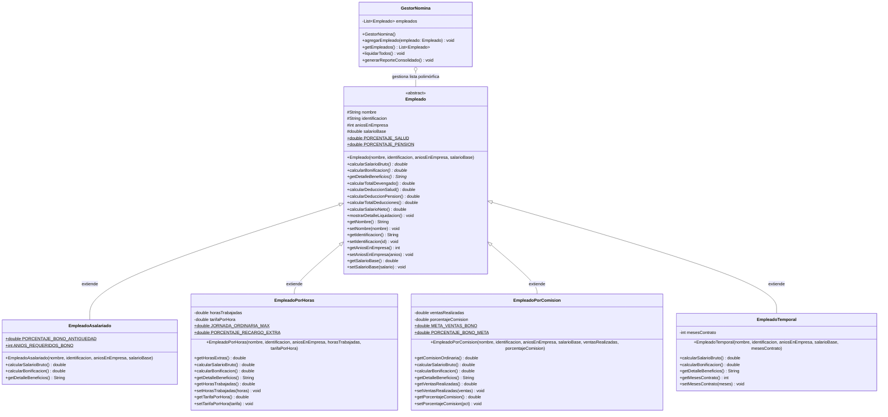

# Diagrama de Clases UML - Sistema de Gestión de Empleados

Este documento presenta la arquitectura del sistema implementado bajo el paradigma de **Programación Orientada a Objetos (POO)** en **Java**, diseñado para su visualización y sustentación en Apache NetBeans y la exposición en YouTube.

---

## 1. Diagrama de Clases UML (Mermaid)

---

## 2. Aplicación de los 4 Pilares de la POO

| Pilar POO | Cómo se aplica en este proyecto |
| :--- | :--- |
| **Abstracción** | La clase `Empleado` no puede ser instanciada directamente (`abstract class`), definiendo el modelo conceptual común y los métodos abstractos obligatorios (`calcularSalarioBruto()`, `calcularBonificacion()`). |
| **Encapsulamiento** | Los atributos son protegidos (`protected`) en la superclase y privados (`private`) en las subclases, accesibles únicamente mediante métodos *getters* y *setters* con validaciones para evitar valores negativos. |
| **Herencia** | Las cuatro subclases especializadas (`EmpleadoAsalariado`, `EmpleadoPorHoras`, `EmpleadoPorComision`, `EmpleadoTemporal`) reutilizan código base (nombre, cédula, salario base, deducciones de ley de salud y pensión). |
| **Polimorfismo** | Una lista homogénea `List<Empleado>` en `GestorNomina` almacena instancias de cualquier subclase. Al invocar `calcularSalarioNeto()` o `mostrarDetalleLiquidacion()`, Java ejecuta dinámicamente la versión especializada de cada subclase en tiempo de ejecución (*dynamic dispatch*). |

---

## 3. Matriz de Reglas de Negocio y Liquidación

| Tipo de Empleado | Salario Bruto | Bonificación / Beneficio Adicional | Deducción Salud (4%) | Deducción Pensión (4%) |
| :--- | :--- | :--- | :--- | :--- |
| **Asalariado** | Salario mensual fijo | +10% anual si `antiguedad > 5 años`; sino $0 | 4% del devengado | 4% del devengado |
| **Por Horas** | Horas trabajadas $\times$ Tarifa normal | +50% de recargo sobre las horas que superen las 40h | 4% del devengado | 4% del devengado |
| **Por Comisión** | Sueldo base + Comisión s/ventas | +5% adicional sobre ventas si `ventas > $2.000.000`; sino $0 | 4% del devengado | 4% del devengado |
| **Temporal** | Salario fijo convenido | $0 (Excluido expresamente de bonos y beneficios) | 4% del devengado | 4% del devengado |

> [!NOTE]
> Las deducciones de ley para **Salud (4%)** y **Pensión (4%)** suman un total del **8%**, calculadas de forma centralizada en la superclase `Empleado`, garantizando uniformidad contable y evitando duplicación de código.
