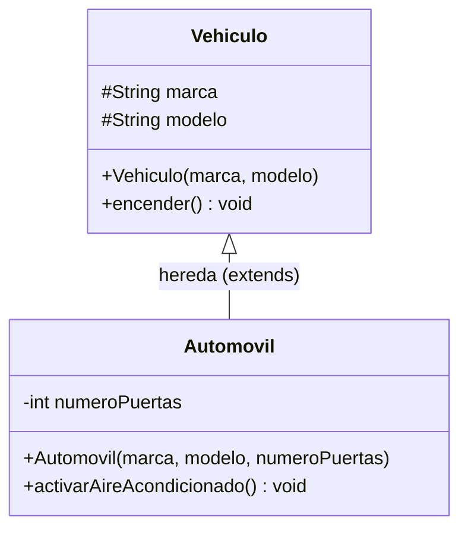
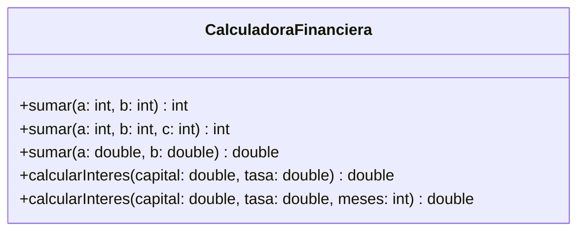
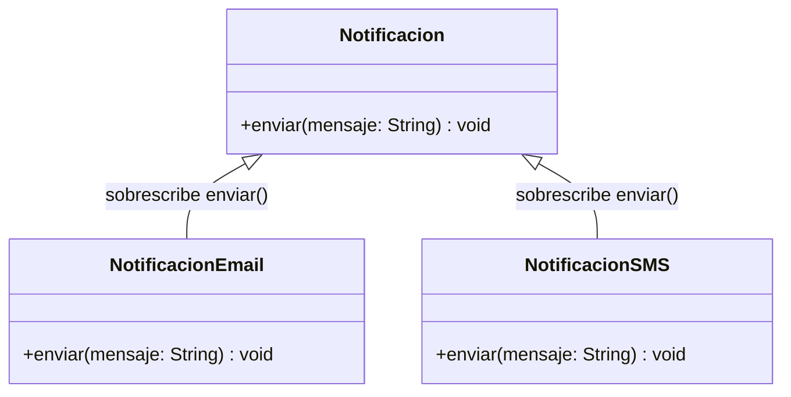
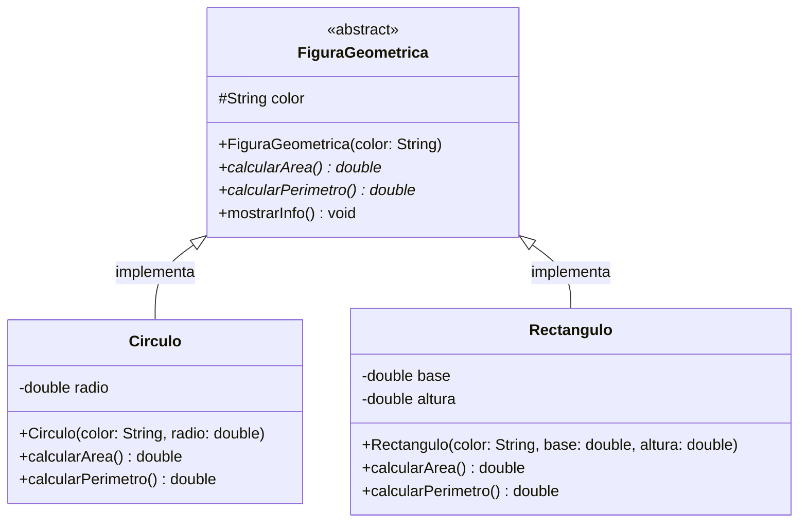
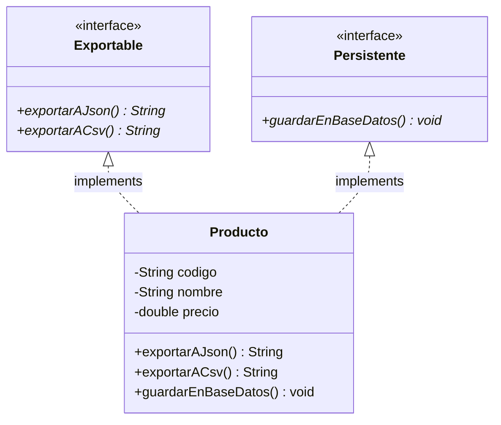
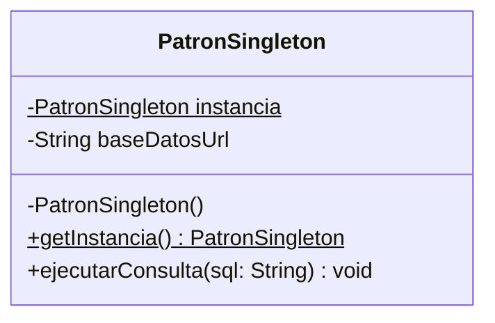
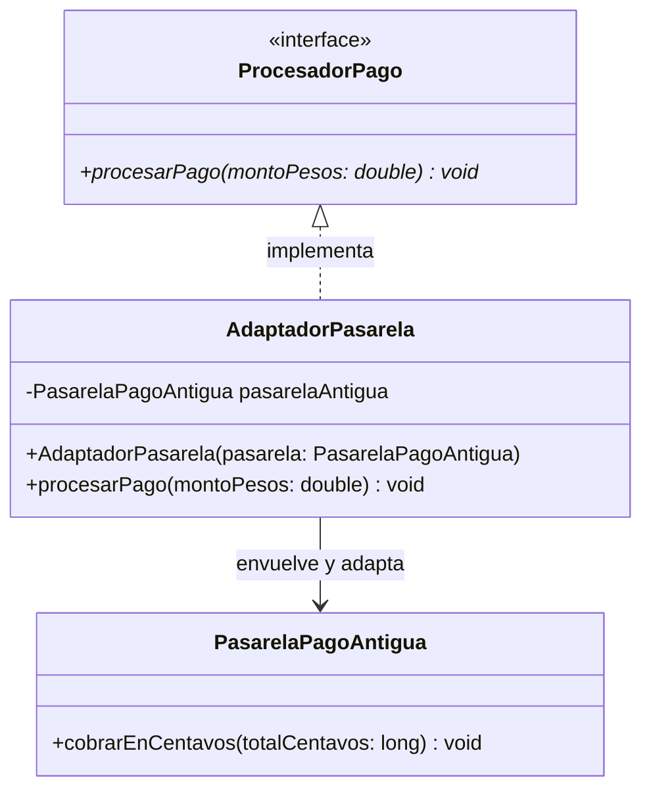
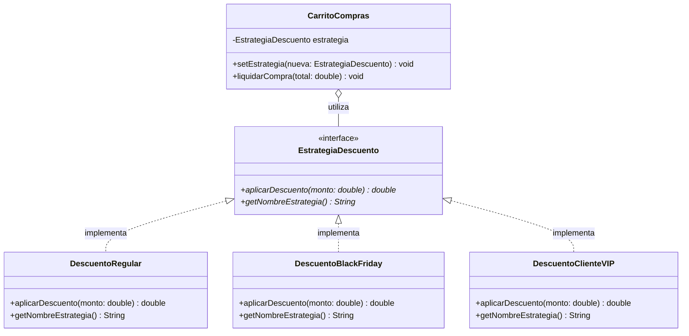

# Investigación Completa: POO Avanzada, Patrones de Diseño y Principios SOLID (Punto 2)

**Actividad:** Programación Orientada a Objetos (POO) - Entrega Individual  
**Referencia bibliográfica oficial de patrones:** [Refactoring Guru - Patrones de Diseño](https://refactoring.guru/es/design-patterns)

---

## 📑 Tabla de Contenidos
1. [Herencia en POO (Concepto, Diagrama UML y Código)](#1-herencia-en-poo)
2. [Sobrecarga de Métodos (Concepto, Diagrama UML y Código)](#2-sobrecarga-de-métodos-overloading)
3. [Sobreescritura de Métodos (Concepto, Diagrama UML y Código)](#3-sobreescritura-de-métodos-overriding)
4. [Clases Abstractas (Concepto, Diagrama UML y Código)](#4-clases-abstractas)
5. [Interfaces en Java (Concepto, Diagrama UML y Código)](#5-interfaces-en-java)
6. [El Modificador `static` en Java (Variables y Métodos de Clase)](#6-el-modificador-static-en-java)
7. [Catálogo General de Patrones de Diseño (GoF / Refactoring Guru)](#7-catálogo-general-de-patrones-de-diseño)
8. [Patrón Creacional: Singleton](#8-patrón-creacional-singleton)
9. [Patrón Estructural: Adapter (Adaptador)](#9-patrón-estructural-adapter-adaptador)
10. [Patrón de Comportamiento: Strategy (Estrategia)](#10-patrón-de-comportamiento-strategy-estrategia)
11. [Principios SOLID de la Programación Orientada a Objetos](#11-principios-solid-en-poo)
12. [Guion de Exposición para el Video de YouTube (Punto 2)](#12-guion-de-exposición-para-youtube-punto-2)

---

## 1. Herencia en POO

### Concepto Teórico
La **herencia** es el mecanismo fundamental de la POO mediante el cual una clase derivada (*subclase* o *clase hija*) adquiere las características (atributos) y comportamientos (métodos) de una clase existente (*superclase* o *clase padre*). 
- **Propósito:** Reutilización de código, modelado de relaciones jerárquicas del tipo *"es un"* (*is-a*) y facilitación del polimorfismo.
- **En Java:** Se implementa con la palabra reservada `extends`. Java soporta herencia simple de clases (una clase solo puede tener una superclase directa).

### Diagrama de Clases UML


### Código en Java
```java
// Superclase
public class Vehiculo {
    protected String marca;
    protected String modelo;

    public Vehiculo(String marca, String modelo) {
        this.marca = marca;
        this.modelo = modelo;
    }

    public void encender() {
        System.out.println("El vehículo " + marca + " " + modelo + " ha encendido su motor.");
    }
}

// Subclase
public class Automovil extends Vehiculo {
    private int numeroPuertas;

    public Automovil(String marca, String modelo, int numeroPuertas) {
        super(marca, modelo); // Invoca el constructor padre
        this.numeroPuertas = numeroPuertas;
    }

    public void activarAireAcondicionado() {
        System.out.println("Aire acondicionado encendido en el auto de " + numeroPuertas + " puertas.");
    }
}
```

---

## 2. Sobrecarga de Métodos (Overloading)

### Concepto Teórico
La **sobrecarga de métodos** ocurre cuando en una misma clase coexisten dos o más métodos con el **mismo nombre**, pero con **diferente firma** (distinto número, tipo u orden de parámetros).
- **Momento de resolución:** En tiempo de compilación (*Compile-time Polymorphism* o polimorfismo estático).
- **Regla:** Cambiar únicamente el tipo de retorno **no** es suficiente para sobrecargar un método; la lista de argumentos debe variar obligatoriamente.

### Diagrama de Clases UML


### Código en Java
```java
public class CalculadoraFinanciera {

    public int sumar(int a, int b) {
        return a + b;
    }

    // Sobrecarga por número de parámetros
    public int sumar(int a, int b, int c) {
        return a + b + c;
    }

    // Sobrecarga por tipo de datos
    public double sumar(double a, double b) {
        return a + b;
    }

    // Sobrecarga de cálculo de interés simple vs a plazo
    public double calcularInteres(double capital, double tasa) {
        return capital * (tasa / 100.0);
    }

    public double calcularInteres(double capital, double tasa, int meses) {
        return (capital * (tasa / 100.0) * meses) / 12.0;
    }
}
```

---

## 3. Sobreescritura de Métodos (Overriding)

### Concepto Teórico
La **sobreescritura de métodos** ocurre cuando una subclase redefine la implementación de un método heredado de su superclase, manteniendo **exactamente el mismo nombre, tipo de retorno y lista de parámetros**.
- **Momento de resolución:** En tiempo de ejecución (*Runtime Polymorphism* o polimorfismo dinámico / *dynamic dispatch*).
- **Buena práctica:** Usar la anotación `@Override` para que el compilador verifique que el método efectivamente existe en la superclase.

### Diagrama de Clases UML


### Código en Java
```java
public class Notificacion {
    public void enviar(String mensaje) {
        System.out.println("[NOTIFICACIÓN ESTÁNDAR]: " + mensaje);
    }
}

public class NotificacionEmail extends Notificacion {
    @Override
    public void enviar(String mensaje) {
        System.out.println("[CORREO ELECTRÓNICO - SMTP]: Formato HTML -> " + mensaje);
    }
}

public class NotificacionSMS extends Notificacion {
    @Override
    public void enviar(String mensaje) {
        System.out.println("[MENSAJE DE TEXTO SMS]: Pasarela GSM -> " + mensaje);
    }
}
```

---

## 4. Clases Abstractas

### Concepto Teórico
Una **clase abstracta** es una clase que **no puede ser instanciada directamente** (no se puede hacer `new ClaseAbstracta()`). Sirve como modelo conceptual base para otras clases.
- Se declara con el modificador `abstract`.
- Puede contener **métodos abstractos** (firmas sin cuerpo que las subclases concretas deben implementar obligatoriamente) y **métodos concretos** (con código funcional compartido).
- Puede tener atributos de instancia, constructores y modificadores de acceso.

### Diagrama de Clases UML


### Código en Java
```java
public abstract class FiguraGeometrica {
    protected String color;

    public FiguraGeometrica(String color) {
        this.color = color;
    }

    // Métodos abstractos (obligatorios para las subclases)
    public abstract double calcularArea();
    public abstract double calcularPerimetro();

    // Método concreto (reutilizable)
    public void mostrarInfo() {
        System.out.printf("Figura %s | Área: %.2f | Perímetro: %.2f%n",
                color, calcularArea(), calcularPerimetro());
    }
}

public class Circulo extends FiguraGeometrica {
    private double radio;

    public Circulo(String color, double radio) {
        super(color);
        this.radio = radio;
    }

    @Override
    public double calcularArea() {
        return Math.PI * radio * radio;
    }

    @Override
    public double calcularPerimetro() {
        return 2 * Math.PI * radio;
    }
}
```

---

## 5. Interfaces en Java

### Concepto Teórico
Una **interfaz** es un contrato estricto de comportamiento 100% puro. Define **qué** debe hacer una clase, pero no **cómo** debe hacerlo.
- Se declara con la palabra clave `interface` y se implementa con `implements`.
- Permite simular **herencia múltiple** en Java (una clase puede implementar tantas interfaces como necesite: `implements Exportable, Persistente`).
- En su concepción clásica, todos sus métodos son implícitamente `public abstract` y sus variables son `public static final` (constantes).

### Diagrama de Clases UML


### Código en Java
```java
public interface Exportable {
    String exportarAJson();
    String exportarACsv();
}

public interface Persistente {
    void guardarEnBaseDatos();
}

// Una clase implementa múltiples interfaces
public class Producto implements Exportable, Persistente {
    private String codigo;
    private String nombre;
    private double precio;

    public Producto(String codigo, String nombre, double precio) {
        this.codigo = codigo;
        this.nombre = nombre;
        this.precio = precio;
    }

    @Override
    public String exportarAJson() {
        return String.format("{\"codigo\": \"%s\", \"precio\": %.2f}", codigo, precio);
    }

    @Override
    public String exportarACsv() {
        return codigo + ";" + nombre + ";" + precio;
    }

    @Override
    public void guardarEnBaseDatos() {
        System.out.println("Guardando producto en base de datos...");
    }
}
```

---

## 6. El Modificador `static` en Java

### Concepto Teórico
El modificador `static` indica que un miembro (atributo o método) **pertenece a la clase misma** y no a ninguna instancia (objeto) individual en particular.
- **Variables `static` (Variables de clase):** Existe una **única copia en memoria** para toda la aplicación, compartida por todas las instancias de esa clase.
- **Métodos `static`:** Se invocan directamente con el nombre de la clase (`NombreClase.metodo()`) sin necesidad de instanciar un objeto con `new`.
- **Restricción:** Dentro de un método estático **no** se puede usar `this` ni acceder directamente a atributos de instancia, ya que el método estático existe independientemente de si hay objetos creados.

### Código en Java
```java
public class CuentaBancaria {
    private String titular;   // Atributo de instancia (uno por cuenta)
    private double saldo;     // Atributo de instancia (uno por cuenta)

    // Atributo estático: contador global compartido por TODAS las cuentas
    public static int totalCuentasCreadas = 0;

    // Constante estática
    public static final double TASA_INTERES_GLOBAL = 0.05;

    public CuentaBancaria(String titular, double saldo) {
        this.titular = titular;
        this.saldo = saldo;
        totalCuentasCreadas++; // Se incrementa el contador de la clase
    }

    // Método estático de utilidad (no requiere una cuenta concreta)
    public static double calcularRendimientoProyectado(double monto, int anios) {
        return monto * Math.pow(1 + TASA_INTERES_GLOBAL, anios);
    }
}
```

---

## 7. Catálogo General de Patrones de Diseño

Los patrones de diseño son soluciones habituales y probadas a problemas recurrentes en el diseño de software orientado a objetos (establecidos formalmente por el *Gang of Four* - GoF y recopilados en [Refactoring Guru](https://refactoring.guru/es/design-patterns)).

Se clasifican en tres grandes familias:

| Familia | Propósito General | Patrones Principales del Catálogo |
| :--- | :--- | :--- |
| **Creacionales** | Abstraen los mecanismos de instanciación, haciendo que el sistema sea independiente de cómo se crean, componen y representan sus objetos. | • Factory Method<br>• Abstract Factory<br>• Builder<br>• Prototype<br>• **Singleton** |
| **Estructurales** | Explican cómo ensamblar objetos y clases en estructuras más grandes a la vez que se mantiene la flexibilidad y eficiencia. | • **Adapter (Adaptador)**<br>• Bridge<br>• Composite<br>• Decorator<br>• Facade (Fachada)<br>• Flyweight<br>• Proxy |
| **De Comportamiento** | Se ocupan de los algoritmos y la asignación de responsabilidades y comunicación efectiva entre objetos. | • Chain of Responsibility<br>• Command<br>• Iterator<br>• Mediator<br>• Memento<br>• Observer<br>• State<br>• **Strategy (Estrategia)**<br>• Template Method<br>• Visitor |

---

## 8. Patrón Creacional: Singleton

### Propósito (según Refactoring Guru)
Garantiza que una clase tenga **una única instancia** en toda la aplicación y proporciona un **punto de acceso global** a dicha instancia.

### Problema que resuelve
El control de acceso a un recurso compartido, como una conexión a base de datos, un gestor de archivos de registro (*logger*) o la configuración central del sistema.

### Diagrama de Clases UML


### Código en Java
```java
public class PatronSingleton {
    // 1. Atributo estático que almacena la única instancia
    private static PatronSingleton instancia;
    private String baseDatosUrl;

    // 2. Constructor privado: impide que otros hagan 'new'
    private PatronSingleton() {
        this.baseDatosUrl = "jdbc:postgresql://servidor.com:5432/nomina_db";
    }

    // 3. Método estático global de acceso
    public static synchronized PatronSingleton getInstancia() {
        if (instancia == null) {
            instancia = new PatronSingleton();
        }
        return instancia;
    }

    public void ejecutarConsulta(String sql) {
        System.out.println("Consultando en " + baseDatosUrl + ": " + sql);
    }
}
```

---

## 9. Patrón Estructural: Adapter (Adaptador)

### Propósito (según Refactoring Guru)
Permite que objetos con **interfaces incompatibles puedan colaborar entre sí**, funcionando como un convertidor entre el formato o firma requerida por el cliente y el servicio existente.

### Problema que resuelve
Cuando una aplicación moderna necesita integrar una librería externa, servicio web legado o componente antiguo cuyos métodos y tipos de datos no encajan con las interfaces del sistema actual.

### Diagrama de Clases UML


### Código en Java
```java
// 1. Interfaz que espera nuestro sistema
public interface ProcesadorPago {
    void procesarPago(double montoPesos);
}

// 2. Servicio externo incompatible (trabaja en centavos)
public class PasarelaPagoAntigua {
    public void cobrarEnCentavos(long centavos) {
        System.out.println("Cobrando " + centavos + " centavos en sistema legado.");
    }
}

// 3. El Adaptador
public class AdaptadorPasarela implements ProcesadorPago {
    private final PasarelaPagoAntigua pasarelaAntigua;

    public AdaptadorPasarela(PasarelaPagoAntigua pasarelaAntigua) {
        this.pasarelaAntigua = pasarelaAntigua;
    }

    @Override
    public void procesarPago(double montoPesos) {
        long centavos = (long) (montoPesos * 100); // Conversión
        pasarelaAntigua.cobrarEnCentavos(centavos);
    }
}
```

---

## 10. Patrón de Comportamiento: Strategy (Estrategia)

### Propósito (según Refactoring Guru)
Permite definir una **familia de algoritmos**, encapsular cada uno en una clase independiente y hacer que sus objetos sean **intercambiables en tiempo de ejecución**.

### Problema que resuelve
Evita anidamientos masivos de estructuras condicionales (`if-else` o `switch`) cuando un proceso o cálculo de negocio puede variar según el contexto o tipo de cliente (por ejemplo, cálculo de descuentos o métodos de envío).

### Diagrama de Clases UML


### Código en Java
```java
// Interfaz Strategy
public interface EstrategiaDescuento {
    double aplicarDescuento(double montoTotal);
    String getNombreEstrategia();
}

// Estrategia Concreta 1 (VIP: 15% de descuento)
public class DescuentoClienteVIP implements EstrategiaDescuento {
    @Override
    public double aplicarDescuento(double montoTotal) {
        return montoTotal * 0.85;
    }
    @Override
    public String getNombreEstrategia() { return "Membresía VIP (15%)"; }
}

// Contexto
public class CarritoCompras {
    private EstrategiaDescuento estrategia;

    public CarritoCompras(EstrategiaDescuento estrategiaInicial) {
        this.estrategia = estrategiaInicial;
    }

    public void setEstrategia(EstrategiaDescuento nuevaEstrategia) {
        this.estrategia = nuevaEstrategia; // Cambio dinámico
    }

    public void liquidarCompra(double total) {
        double totalFinal = estrategia.aplicarDescuento(total);
        System.out.printf("Total con descuento: $%.2f%n", totalFinal);
    }
}
```

---

## 11. Principios SOLID en POO

Los principios **SOLID** son cinco directrices fundamentales de diseño introducidas por Robert C. Martin (*Uncle Bob*) para crear software limpio, mantenible, desacoplado y extensible:

| Letra | Principio | Significado y Definición | Cómo se aplica / Beneficio |
| :---: | :--- | :--- | :--- |
| **S** | **Single Responsibility Principle**<br>*(Responsabilidad Única)* | Una clase debe tener **una sola razón para cambiar**, es decir, debe ocuparse de una única responsabilidad bien delimitada. | En nuestro proyecto, la clase `Empleado` se encarga de modelar el trabajador y liquidar sus fórmulas, mientras que `GestorNomina` se encarga de administrar la colección empresarial de empleados. |
| **O** | **Open/Closed Principle**<br>*(Abierto / Cerrado)* | Las entidades de software deben estar **abiertas para su extensión, pero cerradas para su modificación**. | Si la empresa crea un nuevo contrato (ej. `EmpleadoPracticante`), simplemente creamos una nueva subclase sin tocar ni alterar el código existente en `Empleado` ni en las demás subclases. |
| **L** | **Liskov Substitution Principle**<br>*(Sustitución de Liskov)* | Los objetos de una superclase deben poder ser reemplazados por objetos de sus subclases **sin alterar el funcionamiento correcto del programa**. | Cualquier subclase (`EmpleadoAsalariado`, `EmpleadoPorHoras`, etc.) puede ser tratada indistintamente como un `Empleado` en la lista sin que ocurran excepciones ni errores en el cálculo. |
| **I** | **Interface Segregation Principle**<br>*(Segregación de Interfaces)* | Los clientes no deben ser forzados a depender de interfaces o métodos que no utilizan. Es preferible tener **muchas interfaces pequeñas y específicas** que una interfaz gigantesca. | En lugar de una interfaz monolítica con 20 métodos, creamos interfaces segregadas como `Exportable` (solo exportación) y `Persistente` (solo guardado en BD). |
| **D** | **Dependency Inversion Principle**<br>*(Inversión de Dependencias)* | Los módulos de alto nivel no deben depender de los módulos de bajo nivel; ambos deben **depender de abstracciones**. Las abstracciones no deben depender de detalles, los detalles deben depender de abstracciones. | El `GestorNomina` depende de la abstracción `List<Empleado>`, no de clases concretas como `EmpleadoTemporal` o `EmpleadoPorHoras`. |

---

## 12. Guion de Exposición para YouTube (Punto 2)

**Ubicación sugerida en tu video:** Justo después de la demostración de la nómina o como segunda sección del video.  
**Duración recomendada para este bloque:** 6 a 8 minutos.

```
[00:00 - 02:00] Explicación de Herencia, Sobrecarga vs Sobreescritura
[02:00 - 03:30] Clases Abstractas vs Interfaces y el modificador Static
[03:30 - 05:30] Catálogo de Patrones (Singleton, Adapter, Strategy) con UML y Código
[05:30 - 07:00] Principios SOLID y Cierre
```

### Texto sugerido para la narración:

> **[ESTUDIANTE FRENTE A PANTALLA]:**  
> *"Continuando con el segundo punto de la actividad, abordaremos los conceptos avanzados de Programación Orientada a Objetos y patrones de diseño solicitados.*  
>  
> *Comenzamos con la **Herencia**. Como vimos en el diagrama de clases con el ejemplo de `Vehiculo` y `Automovil`, nos permite reutilizar lógica compartida mediante `extends`.*  
>  
> *Un aspecto fundamental es la diferencia entre **Sobrecarga** y **Sobreescritura**:*
> - *La **Sobrecarga (Overloading)** ocurre en una misma clase cuando tenemos métodos con el mismo nombre pero diferentes parámetros, como en nuestra `CalculadoraFinanciera`. Se resuelve en tiempo de compilación.*
> - *La **Sobreescritura (Overriding)** ocurre entre superclase y subclase con la anotación `@Override`, donde la subclase redefine el comportamiento del método, como vimos en `NotificacionEmail` y `NotificacionSMS`. Se resuelve en tiempo de ejecución mediante polimorfismo dinámico.*  
>  
> *Luego tenemos las **Clases Abstractas** e **Interfaces**:*
> - *Una clase abstracta como `FiguraGeometrica` no puede instanciarse y combina métodos abstractos con métodos concretos y atributos.*
> - *Una **Interfaz** como `Exportable` o `Persistente` es un contrato puro de métodos que permite herencia múltiple de tipos en Java.*  
>  
> *Respecto al modificador **static**, este indica que el atributo o método pertenece a la clase y no a las instancias, como el contador global `totalCuentasCreadas` de nuestra `CuentaBancaria`.*  
>  
> *Pasando a los **Patrones de Diseño**, según el catálogo de Refactoring Guru, se dividen en Creacionales, Estructurales y de Comportamiento:*
> 1. *Como patrón **Creacional**, implementamos el **Singleton**, que asegura una única instancia de conexión mediante un constructor privado y un método `getInstancia()`.*
> 2. *Como patrón **Estructural**, el **Adapter**, que permite que una pasarela de pagos antigua en centavos colabore fluidamente con nuestra interfaz moderna en pesos.*
> 3. *Como patrón **De Comportamiento**, el patrón **Strategy**, que permite alternar algoritmos de descuento (VIP, Black Friday o regular) en caliente sin usar `if-else` interminables.*  
>  
> *Por último, sustentamos los **Principios SOLID**: Responsabilidad Única, Abierto/Cerrado, Sustitución de Liskov, Segregación de Interfaces e Inversión de Dependencias, los cuales garantizan un código modular, robusto y fácil de mantener.*  
>  
> *Veamos ahora la ejecución de todos estos ejemplos en la consola de NetBeans con la opción 5.*  
> *[Ejecutar y mostrar que todos los ejemplos arrojan salida correcta].*  
>  
> *Con esto completamos de manera integral los puntos 1 y 2 de la actividad. ¡Muchas gracias!"*
